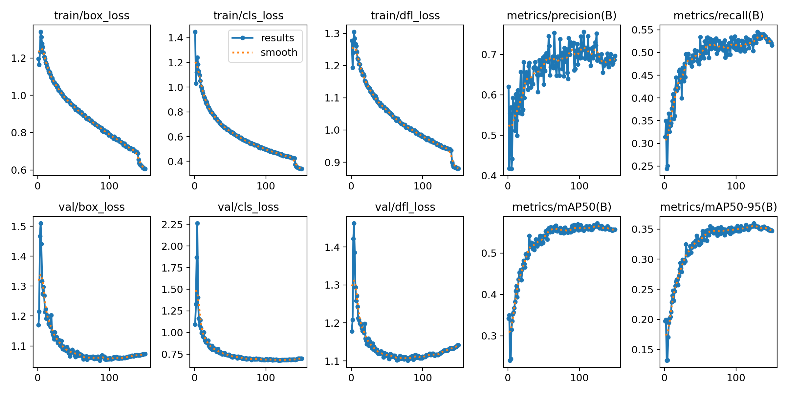
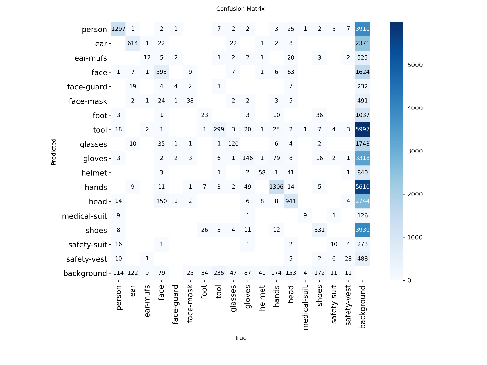

# PPE Detection

### Компьютерное зрение для контроля СИЗ и опасных зон на стройплощадке

**От обнаружения человека в кадре — до события с подтверждающим снимком.**

PPE Detection анализирует видео, отслеживает людей, проверяет наличие каски и сигнального жилета и отмечает попадание в заданную опасную зону. Оператор может наблюдать за обработкой через веб-интерфейс и просматривать журнал событий со снимками.

Учебный проект для хакатона по промышленной безопасности: две обученные модели, обработка видео, трекинг и экспорт в ONNX.

**YOLO11 · ByteTrack · 17 классов v2 · Веб-интерфейс · JPG / JSON / JSONL · ONNX**

[Возможности](#возможности) · [Результаты](#модели-и-результаты) · [Быстрый запуск](#быстрый-запуск) · [Опасная зона](#настройка-опасной-зоны) · [ONNX и LinQ](#onnx-и-linq)

## Проект в работе


*Реальный кадр из сохранённых событий проекта: люди отслеживаются по ID, каски и жилеты сопоставляются с человеком. Красный контур обозначает опасную зону, метка `DANGER` — попадание человека в неё. `H` — каска, `V` — жилет.*

### Начало наблюдения


*В начале видео часть оценок имеет статус `?`: приложению нужны дополнительные наблюдения. Эти снимки показывают обработку видео, а не веб-интерфейс.*

## Возможности

| Возможность | Что получает пользователь |
|---|---|
| **Детекция и трекинг** | Люди и предметы СИЗ на кадре; ID людей между кадрами с помощью ByteTrack |
| **Проверка каски и жилета** | Статусы наличия СИЗ с учётом видимости человека и истории наблюдений |
| **Опасная зона** | Настройка области на первом кадре и уведомления при попадании человека в неё |
| **Сохранение событий** | JPG-снимок и JSON с ID человека, временем видео и типом события |
| **Веб-интерфейс** | Стрим с камеры, количество людей, уведомления, FPS и журнал с превью |
| **Управление и экспорт** | Запуск, пауза и остановка в веб-интерфейсе; экспорт журнала в JSONL |
| **Просмотр видео** | Пауза, ручные снимки и сохранение последнего кадра на экране после окончания видео |

### Как определяется событие

Модель v2 находит человека и предметы. Приложение сопоставляет каски, жилеты и перчатки с областями тела и накапливает наблюдения. Каждый предмет может принадлежать только одному человеку; неоднозначные совпадения получают статус «недостаточно данных».

| Статус на кадре | Значение |
|---|---|
| `OK` | Предмет найден |
| `MISS?` | Возможное отсутствие СИЗ |
| `?` | Недостаточно данных для оценки |

Уведомление о возможном отсутствии каски или жилета появляется после **минимум 2 секунд и 5 наблюдений**. При оценке видимости учитываются положение и размер человека в кадре. Перчатки отображаются справочно.

Для опасной зоны проверяется **нижняя центральная точка рамки человека**. Попадание в область вызывает уведомление сразу. События одной пары «ID человека / тип события» повторяются не чаще раза в **5 секунд**; смена ID может вызвать повторное уведомление. Счётчик `Events` показывает число уведомлений.

## Модели и результаты

Проект прошёл два этапа: **v1 — базовая детекция СИЗ**, **v2 — модель для текущего видеоприложения**.

| Параметр | v1 · Базовая модель | v2 · Текущая модель |
|---|---:|---:|
| Архитектура | YOLO11n | YOLO11s |
| Датасет | Construction-PPE | SH17 |
| Изображения train / val | 1 132 / 143 | 4 681 / 826 |
| Классы | 11 | 17 |
| Эпохи | 50 | 150 |
| Размер входа | 640 × 640 | 640 × 640 |
| mAP50 | 0.5956 | 0.5719 |
| mAP50–95 | 0.2942 | 0.3592 |
| Precision | 0.5626 | 0.6862 |
| Recall | 0.5976 | 0.5345 |

**Почему для приложения выбрана v2.** У v1 есть отдельные классы отсутствия СИЗ — например, `no_helmet`. У v2 таких классов нет: она обнаруживает людей и предметы, а правила проверки реализованы в приложении. Это позволяет отдельно настраивать обязательные СИЗ, сопоставление предметов с людьми и время подтверждения события.

> Модели оценены на разных датасетах и наборах классов, поэтому таблица описывает два эксперимента, а не прямое соревнование моделей. Для сравнения в рабочих условиях нужен общий набор видео.

Для v1 приведены метрики эпохи **47** с максимальным mAP50–95 из [`results.csv`](runs/detect/train-16/results.csv). Для v2 — итоговая валидация `best.pt` из описания эксперимента: **826 изображений и 8 258 объектов**.

Обучение v1 заняло около **38 минут**, v2 — около **3 часов на Tesla T4**. Для v2 при валидации указано около **5 мс на изображение для инференса модели**; это не измерение FPS всего приложения с трекингом, интерфейсом и сохранением событий.

### Графики обучения v2



*Динамика обучения текущей модели за 150 эпох.*

### v2 — матрица ошибок и качество ключевых классов



| Класс | Описание | mAP50 | Recall | Объектов в валидации |
|---|---|---:|---:|---:|
| `person` | Человек | 0.860 | 0.841 | 1 493 |
| `helmet` | Каска | 0.537 | 0.449 | 112 |
| `safety-vest` | Сигнальный жилет | 0.295 | 0.197 | 61 |
| `gloves` | Перчатки | 0.425 | 0.419 | 332 |
| `glasses` | Очки | 0.643 | 0.637 | 212 |
| `shoes` | Обувь | 0.512 | 0.502 | 576 |

Детекция жилета остаётся одним из направлений улучшения: на валидации этот класс представлен 61 объектом и имеет Recall 0.197. Отсутствие детекции само по себе не доказывает отсутствие СИЗ.

Полный список классов SH17 в порядке ID от 0 до 16:

```text
person, ear, ear-mufs, face, face-guard, face-mask, foot, tool,
glasses, gloves, helmet, hands, head, medical-suit, shoes,
safety-suit, safety-vest
```

Классы `glasses` и `shoes` обозначают очки и обувь без оценки их защитных свойств.


### Пример детекции v1


*Валидационный батч первой модели: рамки объектов, названия классов и уверенность предсказаний.*

### Графики обучения v1


*Базовый эксперимент: 50 эпох; лучшие mAP50 и mAP50–95 достигнуты на эпохе 47.*

### v1 — матрица ошибок и датасет


Construction-PPE содержит **1 416 изображений**: 1 132 train, 143 val и 141 test. Метрики в таблице выше относятся к валидации, а не к независимому тестовому набору.

Классы в порядке ID от 0 до 10:

```text
helmet, gloves, vest, boots, goggles, none, Person,
no_helmet, no_goggle, no_gloves, no_boots
```

Параметры запуска: [`args.yaml`](runs/detect/train-16/args.yaml). В нём сохранены исторические локальные пути; для повторного запуска их нужно заменить.


## Быстрый запуск

Рабочее окружение проекта: **Windows · Python 3.11.9 · PyTorch 2.6.0+cu124 · Ultralytics 8.4.177**. Команды ниже предназначены для PowerShell и выполняются из корня проекта.

### 1. Установите зависимости

Замените `C:\model Y` на путь к проекту:

```powershell
cd "C:\model Y"
py -3.11 -m venv .venv
$py = ".\.venv\Scripts\python.exe"
& $py -m pip install --upgrade pip
& $py -m pip install torch==2.6.0 torchvision==0.21.0 --index-url https://download.pytorch.org/whl/cu124
& $py -m pip install -r requirements.txt
& $py -m pip install "lap>=0.5.12"
```

Активировать окружение не обязательно: команды обращаются к его Python напрямую. `lap` нужен для трекинга; сборка CUDA требует совместимого драйвера NVIDIA.

### Запуск без видеокарты NVIDIA

Вместо команды установки PyTorch с CUDA используйте CPU-сборку:

```powershell
& $py -m pip install torch==2.6.0 torchvision==0.21.0 --index-url https://download.pytorch.org/whl/cpu
```

В командах запуска видео замените `--device 0` на `--device cpu`.


### 2. Подготовьте модель и видео

| Файл | Назначение |
|---|---|
| `best_v2.pt` | Веса текущей модели в корне проекта |
| `videos/construction.mp4` | Видео по умолчанию |

Для обработки видео скачивать обучающий датасет не нужно. Другую модель можно указать через `--model`, другое видео — через `--source`.

### 3. Запустите обработку

```powershell
$py = ".\.venv\Scripts\python.exe"
& $py .\videores.py --device 0
```

Со своим видео и явным путём к модели:

```powershell
& $py .\videores.py --device 0 --model .\best_v2.pt --source "C:\media\test.mp4"
```

### 4. Откройте веб-интерфейс

Для запуска веб-сервера:

```powershell
& $py -m pip install -r requirements-web.txt
& $py .\app.py --device 0
```

Откройте [localhost:8000](http://localhost:8000). В интерфейсе доступны стрим, счётчики, управление обработкой и журнал событий с экспортом в JSONL.

Запуск приведён по `WEB_SETUP.md`. В переданном архиве есть инструкция и `requirements-web.txt`, но отсутствуют `app.py`, `ppe_logic.py` и `web/index.html`: для веб-режима нужен полный комплект этих файлов. Обработка через `videores.py` запускается отдельно.

## Настройка опасной зоны

Задайте область на первом кадре видео:

```powershell
& $py .\videores.py --setup-zone
```

| Действие | Управление |
|---|---|
| Добавить вершину | Левая кнопка мыши |
| Удалить последнюю вершину | Правая кнопка мыши |
| Очистить точки | `R` |
| Сохранить зону | `Enter` |
| Отменить настройку | `Esc` |

Выбирайте точки по периметру участка пола. Многоугольник должен быть **выпуклым и без пересечений**.

Запустите обработку с сохранённой зоной:

```powershell
& $py .\videores.py --device 0 --zone-file .\zone.json
```

Без `--zone-file` проверка зоны отключена. В `zone.json` хранятся нормализованные координаты, источник и размер кадра. Для другого видео или ракурса создайте зону заново, передав нужный `--source` при настройке и обработке.

## Обучение и воспроизводимость

Параметры v1 сохранены в [`args.yaml`](runs/detect/train-16/args.yaml), параметры v2 — в `train_args` файла `best_v2.pt`.

### Команды обучения v1 и v2

Разместите датасеты локально и укажите свои пути к `data.yaml`. Команды отражают основные параметры исходных запусков.

**v1 — YOLO11n / Construction-PPE**

```powershell
.\.venv\Scripts\yolo.exe detect train model=yolo11n.pt data="C:/datasets/construction-ppe/data.yaml" epochs=50 imgsz=640 batch=4 device=0 workers=8 cache=False patience=15 optimizer=auto seed=0
```

**v2 — YOLO11s / SH17**

```powershell
.\.venv\Scripts\yolo.exe detect train model=yolo11s.pt data="C:/datasets/sh17/data.yaml" epochs=150 imgsz=640 batch=32 device=0 workers=8 patience=40 optimizer=auto seed=42
```

При нехватке памяти уменьшите `batch`. При проблемах с загрузкой данных на Windows можно использовать `workers=0`. Это изменит конфигурацию относительно исходного эксперимента.

Ultralytics сохраняет веса, метрики и графики в новый каталог внутри `runs/detect/`. Для обработки видео передайте путь к новым весам через `--model`; текущая логика `videores.py` рассчитана на схему классов SH17.

Исходный `YOLO_v1.py` содержит локальный путь к данным: замените его перед запуском. `from pathlib import Path.py` — ранний эксперимент на 3 эпохи.


### Повторная валидация моделей

**v1:**

```powershell
.\.venv\Scripts\yolo.exe val model="runs/detect/train-16/weights/best.pt" data=construction-ppe.yaml split=val imgsz=640 device=cpu
```

Для оценки на тестовой части Construction-PPE замените `split=val` на `split=test`.

**v2:**

```powershell
.\.venv\Scripts\yolo.exe val model=best_v2.pt data="C:/datasets/sh17/data.yaml" split=val imgsz=640 device=0
```

Для воспроизводимости сохраняйте версию датасета, конфигурацию разбиения, зависимости и параметры запуска вместе с результатами.


## ONNX и LinQ

Обе модели экспортированы в ONNX: `best_v1.onnx` и `best_v2.onnx`. Для v2 используется **opset 12 · batch 1 · фиксированный вход 640 × 640 · FP32**. Подавление повторных рамок — NMS — выполняется вне модели.

**Интеграция с LinQ — следующий этап.** Запуск на ускорителе пока не проверен и требует SDK производителя. Предстоит согласовать операторы, IR/opset, предобработку и декодирование выходов. Трекинг, проверка зоны и обработка событий остаются в приложении.

### Экспорт v2 и проверка структуры ONNX

```powershell
& $py -m pip install onnx onnxruntime
& $py -c "from ultralytics import YOLO; YOLO('best_v2.pt').export(format='onnx', opset=12, imgsz=640, batch=1, dynamic=False, simplify=False, half=False, nms=False, device='cpu')"
& $py -c "import onnx; m=onnx.load('best_v2.onnx'); onnx.checker.check_model(m); print('IR:', m.ir_version, 'opset:', [(x.domain,x.version) for x in m.opset_import])"
```

Экспорт создаёт или заменяет `best_v2.onnx` рядом с весами. Проверка структуры не заменяет сравнение предсказаний PyTorch и ONNX Runtime на одинаковых кадрах.

`test_onnx.py` загружает `best_v1.onnx`, обрабатывает изображение из Construction-PPE на CPU и выводит формы входа и выхода. Перед запуском укажите в `DATASET_ROOT` путь к локальному датасету:

```powershell
& $py .\test_onnx.py
```