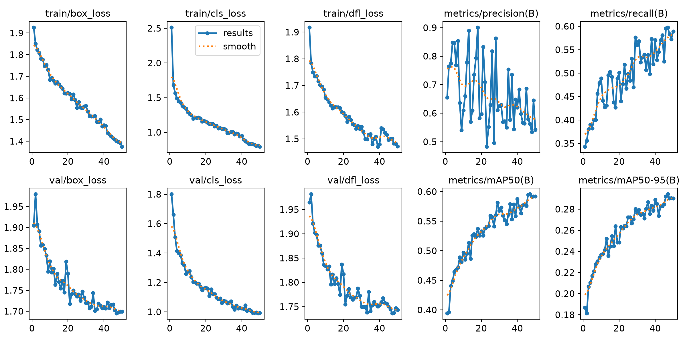
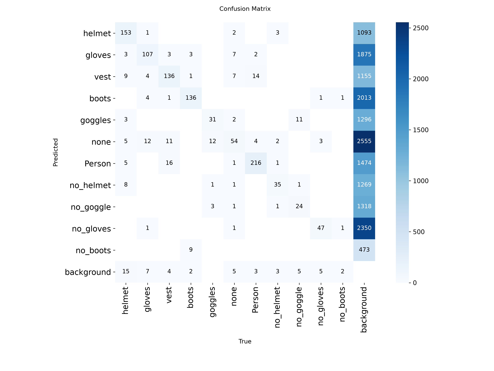
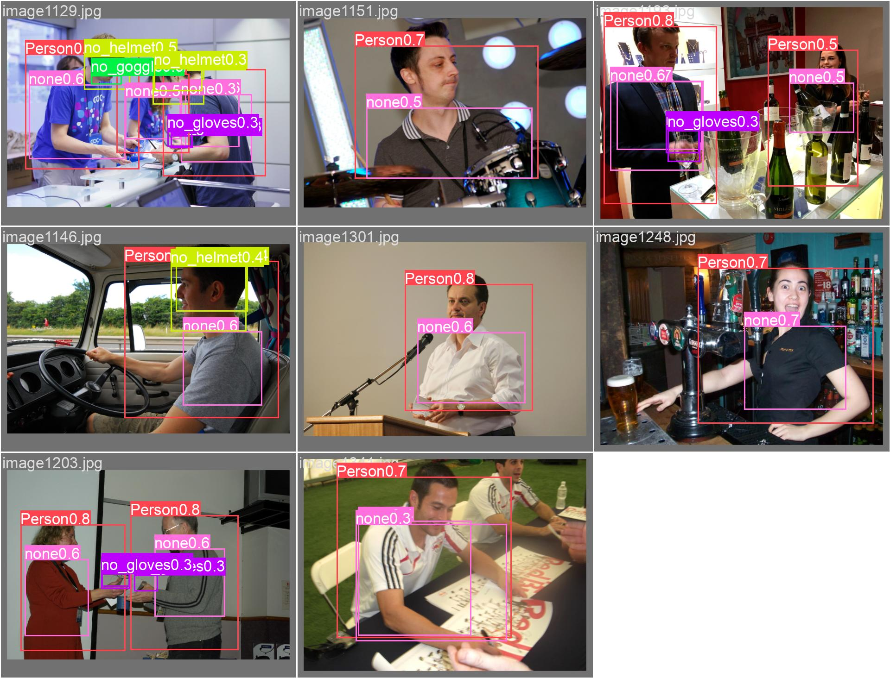

# 🦺 PPE Detection

### Детекция средств индивидуальной защиты на строительной площадке

Учебный прототип для хакатона по промышленной безопасности: **YOLO11n**, обученная на **Construction-PPE**, распознаёт людей, средства защиты и отдельные категории отсутствующих СИЗ.

**50 эпох · 11 классов · mAP50 ≈ 0.60 · обученные веса в репозитории**


## Что уже готово

- Обучение YOLO11n и сохранённые веса `best.pt`.
- Метрики по эпохам, графики обучения и матрица ошибок.
- Пример предсказаний на валидационных изображениях.
- Запуск предсказаний на фото и видео через CLI Ultralytics.

Контроль опасных зон, веб-интерфейс, оповещения и интеграция с LinQ — **следующие этапы**, а не реализованные функции этой версии.

## Результаты обучения



Источник: [`results.csv`](runs/detect/train-16/results.csv), запуск `train-16`. Значения ниже относятся к валидации во время обучения, а не к независимому тестовому набору.

| Метрика | Эпоха 47 — максимум mAP50-95 | Последняя эпоха — 50 |
|---|---:|---:|
| mAP50 | 0.5956 | 0.5917 |
| mAP50–95 | 0.2942 | 0.2904 |
| Precision | 0.5626 | 0.5414 |
| Recall | 0.5976 | 0.5889 |

Максимальный mAP50 — **0.59559**, максимальный mAP50–95 — **0.29422**; оба значения достигнуты на эпохе 47. CSV показывает около **38 минут** суммарного времени к последней эпохе. Скорость инференса в этом репозитории отдельно не измерена.

Точное качество сохранённого `best.pt` можно проверить повторной валидацией. До внедрения нужны испытания на реальных камерах и анализ ошибок по каждому классу.

<details>
<summary>Матрица ошибок</summary>



</details>

## Пример детекции



Это исходный `val_batch0_pred.jpg` из обучения: примеры валидации, а не демонстрация работающего контроля опасных зон.

## Стек и параметры

| Компонент | Значение |
|---|---|
| Модель | YOLO11n |
| Библиотека | Ultralytics 8.4.177 — из метаданных checkpoint |
| Обучение | 50 эпох, batch 4, размер 640 × 640 |
| Параметры исходного запуска | workers 8, patience 15, optimizer auto |
| Данные | Construction-PPE, 11 классов |
| Рабочая среда автора | Windows 11, Python 3.11.9, GTX 3070 8 GB  |
| Целевая интеграция | ONNX / LinQ — планируется |

Параметры исходного запуска: [`args.yaml`](runs/detect/train-16/args.yaml). В нём сохранены исторические локальные пути; на другом компьютере их нужно заменить.

## Быстрый запуск

Команды ниже выполняются в **PowerShell** из папки проекта. Требуется установленный Python 3.11.

### 1. Виртуальное окружение

```powershell
cd "C:\model Y"
py -3.11 -m venv .venv
.\.venv\Scripts\python.exe -m pip install --upgrade pip
```

Активировать окружение не обязательно: команды используют его Python напрямую.

### 2. Зависимости

Для указанной автором конфигурации PyTorch 2.6 / CUDA 12.4:

```powershell
.\.venv\Scripts\python.exe -m pip install torch==2.6.0 torchvision==0.21.0 --index-url https://download.pytorch.org/whl/cu124
.\.venv\Scripts\python.exe -m pip install -r requirements.txt
.\.venv\Scripts\python.exe -c "import torch; print('CUDA:', torch.cuda.is_available())"
```

Для компьютера без NVIDIA вместо первой команды используйте:

```powershell
.\.venv\Scripts\python.exe -m pip install torch==2.6.0 torchvision==0.21.0 --index-url https://download.pytorch.org/whl/cpu
```

Сборка CUDA требует совместимого драйвера NVIDIA. Зависимости здесь не являются полным lock-файлом; запуск в новом окружении необходимо проверить.

### 3. Предсказание на фото или видео

Замените путь `C:/media/test.jpg` на существующий файл. Скачивать датасет для инференса не нужно.

```powershell
.\.venv\Scripts\yolo.exe predict model="runs/detect/train-16/weights/best.pt" source="C:/media/test.jpg" imgsz=640 conf=0.25 save=True device=cpu
.\.venv\Scripts\yolo.exe predict model="runs/detect/train-16/weights/best.pt" source="C:/media/video.mp4" imgsz=640 conf=0.25 save=True device=cpu
```

Для NVIDIA GPU замените `device=cpu` на `device=0`. Ultralytics выводит путь сохранённых результатов в терминал; новые результаты не попадают в Git.

## Датасет

[Construction-PPE от Ultralytics](https://docs.ultralytics.com/datasets/detect/construction-ppe/) содержит **1 416 изображений**: 1 132 train, 143 val и 141 test.

| ID | Класс | Значение |
|---|---|---|
| 0 | helmet | Каска |
| 1 | gloves | Перчатки |
| 2 | vest | Жилет |
| 3 | boots | Защитная обувь |
| 4 | goggles | Защитные очки |
| 5 | none | Категория none в разметке |
| 6 | Person | Человек |
| 7 | no_helmet | Нет каски |
| 8 | no_goggle | Нет очков |
| 9 | no_gloves | Нет перчаток |
| 10 | no_boots | Нет защитной обуви |

Датасет не включён в репозиторий. Для загрузки и обучения можно использовать встроенную конфигурацию Ultralytics `construction-ppe.yaml`:

```powershell
.\.venv\Scripts\yolo.exe detect train model=yolo11n.pt data=construction-ppe.yaml epochs=50 imgsz=640 batch=4 device=0 workers=0 patience=15 name=ppe_v2
```

При первом запуске потребуются интернет и место для датасета. Путь загрузки определяется настройками Ultralytics. `workers=0` — простой вариант запуска на Windows; в исходном эксперименте было `workers=8`.

### Исходный скрипт обучения

`YOLO_v1.py` сохранён без изменения алгоритма. Перед запуском замените аргумент `data` на путь к вашему `data.yaml` либо на `"construction-ppe.yaml"` для встроенной конфигурации. При нехватке ресурсов уменьшите `workers` до 0.

```powershell
.\.venv\Scripts\python.exe YOLO_v1.py
```

Файл `from pathlib import Path.py` — исходный короткий эксперимент на 3 эпохи; он тоже содержит локальный путь к данным.

### Проверка весов

```powershell
.\.venv\Scripts\yolo.exe val model="runs/detect/train-16/weights/best.pt" data=construction-ppe.yaml split=val imgsz=640 device=cpu
```

Для отдельной тестовой оценки замените `split=val` на `split=test`.

## Экспорт в ONNX

```powershell
.\.venv\Scripts\python.exe -m pip install onnx onnxslim onnxruntime
.\.venv\Scripts\yolo.exe export model="runs/detect/train-16/weights/best.pt" format=onnx imgsz=640 simplify=True
```

Экспорт создаёт `best.onnx` рядом с весами. ONNX-файлы исключены из Git как генерируемые артефакты. Совместимость с LinQ ещё нужно проверить по требованиям его SDK: opset, формы входов, препроцессинг и постобработка. Сам экспорт не подтверждает готовность модели к ускорителю.

## Состав репозитория

| Путь | Содержимое |
|---|---|
| `YOLO_v1.py` | Исходный скрипт обучения |
| `from pathlib import Path.py` | Короткая проверка обучения |
| `requirements.txt` | Основные Python-зависимости |
| `.gitignore` | Исключения для данных, кэша и новых запусков |
| `GITHUB_SETUP.md` | Первая публикация и следующие коммиты |
| `screenshots/detection.jpg` | Пример предсказаний |
| `runs/detect/train-16/weights/best.pt` | Обученные веса, около 5.5 MB |
| `runs/detect/train-16/results.csv` | История метрик |
| `runs/detect/train-16/results.png` | График, отображаемый в README |
| `runs/detect/train-16/confusion_matrix.png` | Матрица ошибок |
| `runs/detect/train-16/args.yaml` | Исходная конфигурация запуска |


## Документация

- [Ultralytics: предсказания](https://docs.ultralytics.com/modes/predict/)
- [Ultralytics: Construction-PPE](https://docs.ultralytics.com/datasets/detect/construction-ppe/)
- [PyTorch: установка предыдущих версий](https://pytorch.org/get-started/previous-versions/)
- [VS Code: репозитории и публикация](https://code.visualstudio.com/docs/sourcecontrol/repos-remotes)
